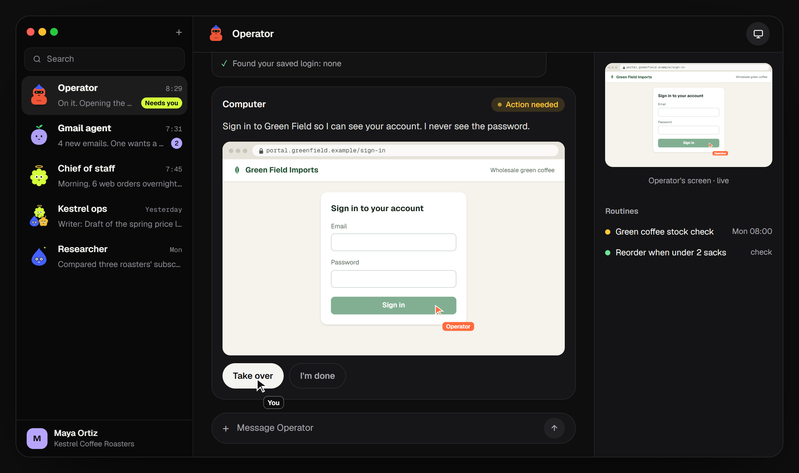
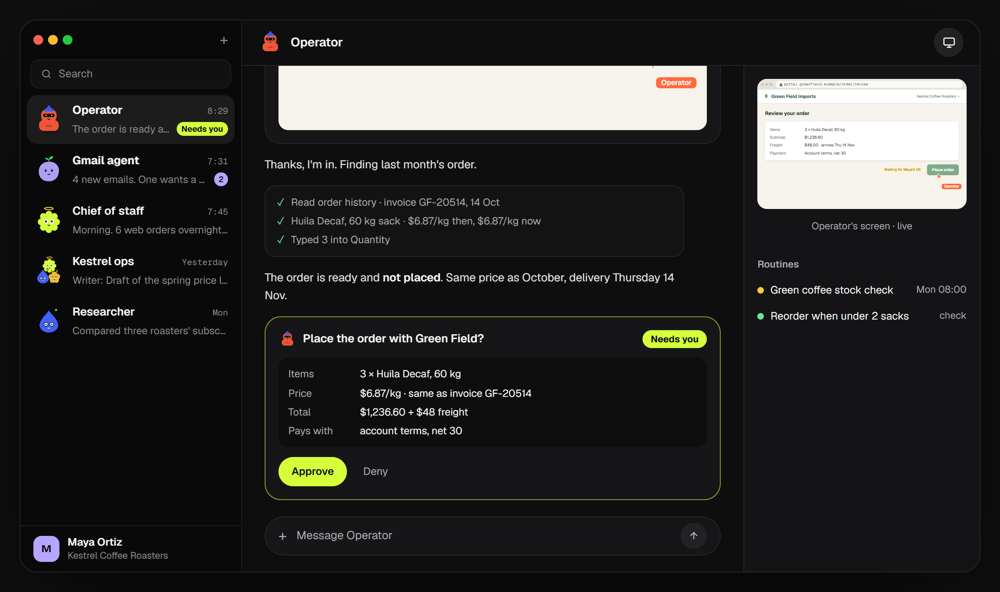
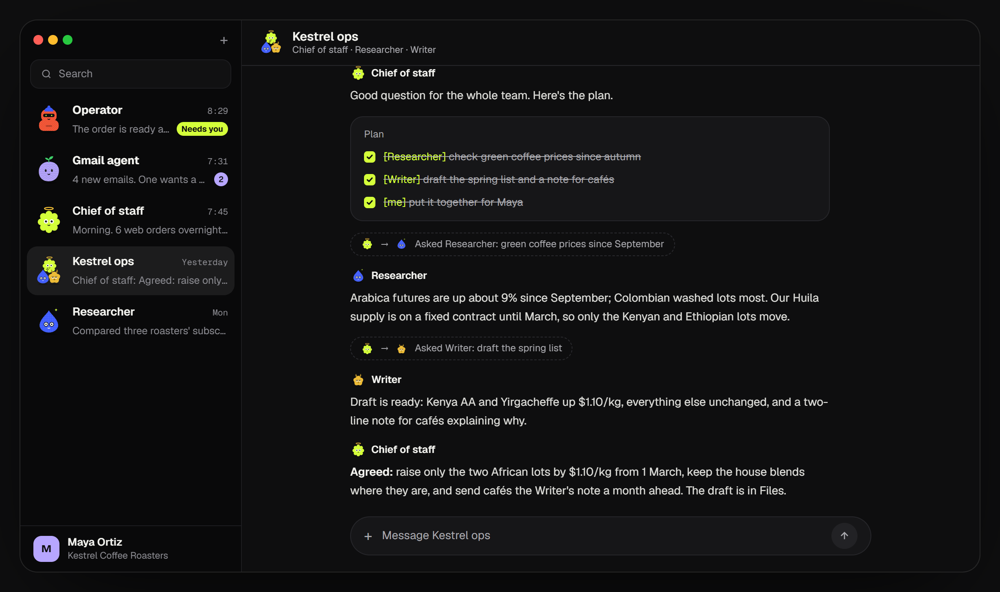
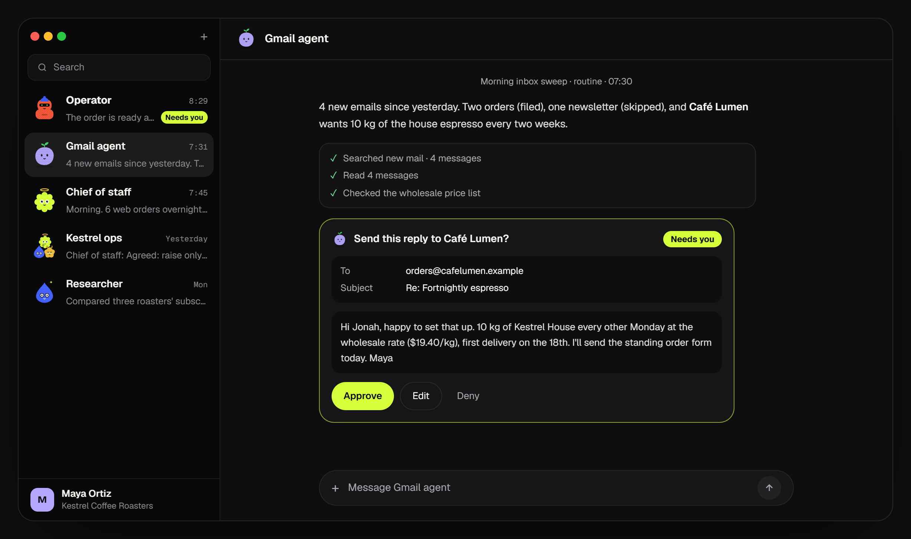

<div align="center">

# One-for-All

**A self-hosted team of AI agents. One job each, their own computers, and they ask before anything leaves.**

<p>
  
  
  
  
  
  
  
  
  
  
  
  
  
  
  
</p>
<p>
  
  
  
  
  
  
</p>



<sub>From the interactive demo on the landing page (<code>apps/site</code>). Kestrel Coffee and its supplier are made up.</sub>

</div>

Each agent has one job, its own sandboxed computer (browser, terminal, files and desktop apps), the tools you grant it, a memory you can read and routines that run on a clock. Everything runs on your own machine, with models through your own OpenRouter key or local Ollama.

> **Status:** the web app, the agent harness, the computer, apps over MCP with approvals, teams with handoffs and discussions, routines, memory and skills are built. **Next:** the phone app, Telegram and Slack (M6). See [the tracker](docs/planning/TRACKER.md).

## What it does

### Nothing leaves without you

Agents work on their own computer and stop for your OK before they buy, send or sign in. You see exactly what will happen, and you can take over the screen at any time.



### A team, not a chatbot

Ask the group, and a chief of staff plans, hands each part to the agent whose job it is, ticks the plan off as answers come back, and pins one agreed answer.



### Work on a clock

Routines and quiet checks run while you sleep and post only what needs you, with drafts you can edit before they go.



## Install (self-host)

**You need:** Docker with Compose v2, about 3 GB of free RAM once agents run (the foundation alone uses about 250 MB), and an x86-64 or arm64 machine. A spare laptop, a Mac mini, a Raspberry Pi 5 (8 GB) or an Oracle Cloud Always Free VM all work.

```sh
git clone <this repository> one-for-all
cd one-for-all

# 1. Generate secrets into infra/compose/.env (run once; it never overwrites)
sh infra/scripts/init-env.sh

# 2. Build and start the app, Postgres and Inngest
docker compose -f infra/compose/docker-compose.selfhost.yml up -d --build
```

Open <http://localhost:3000>. The first visit asks you to create the owner account and your workspace; after that, public sign-up is closed.

On Windows, run step 1 in Git Bash or WSL.

**Keep `infra/compose/.env` private and backed up.** It holds the database passwords and `VAULT_KEY`, which encrypts stored credentials. Losing it means losing access to them. To rotate `VAULT_KEY`, put a new key in it, move the old one to `VAULT_PREVIOUS_KEYS`, and restart; the app re-wraps everything and logs when the old key can be removed.

### Local-only by default

The app is published on `127.0.0.1` only, so other devices on your network cannot reach it. Postgres and Inngest are not published at all. The app also rejects requests whose `Host` or `Origin` it does not recognise, which blocks malicious web pages from talking to it through your browser. To use it from your phone, put it on your Tailscale network and add the machine name to `ALLOWED_HOSTS` in `infra/compose/.env`.

To use a different port, change `APP_PORT` and `APP_URL` in `infra/compose/.env` together.

### Everyday commands

```sh
docker compose -f infra/compose/docker-compose.selfhost.yml ps        # status
docker compose -f infra/compose/docker-compose.selfhost.yml logs -f   # logs
docker compose -f infra/compose/docker-compose.selfhost.yml down      # stop (data is kept)
docker compose -f infra/compose/docker-compose.selfhost.yml up -d --build   # update after pulling new code
```

Database migrations run automatically when the app starts.

## Develop

**You need:** Node 24 (see `.nvmrc`), pnpm 12.3.4 and Docker.

```sh
pnpm install
cp .env.example .env      # then set AUTH_SECRET (the file says how)
pnpm infra:up             # Postgres + Inngest dev server in Docker, on 127.0.0.1
pnpm --filter @ofa/db db:migrate
pnpm dev                  # API on :3000, web app on http://localhost:5173
```

Only the infrastructure runs in Docker during development; the API and web app run natively with hot reload. Vite proxies `/api` to the API.

| Command | What it does |
|---|---|
| `pnpm dev` | Run the API and web app in watch mode |
| `pnpm build` | Build every package (API bundle, web app) |
| `pnpm lint` | ESLint, including the import-boundary rules |
| `pnpm typecheck` | TypeScript in every package |
| `pnpm test` | Unit tests (no Docker needed) |
| `pnpm test:integration` | Integration tests against Postgres (needs `pnpm infra:up`) |
| `pnpm format` / `pnpm format:check` | Prettier |
| `pnpm infra:up` / `infra:down` / `infra:reset` | Start, stop, or stop and delete dev services |
| `pnpm --filter @ofa/db db:generate` | Create a migration from schema changes |
| `pnpm --filter @ofa/db db:migrate` | Apply migrations to the dev database |
| `pnpm --filter @ofa/api db:seed` | Create a dev owner, workspace and sample agents |

Integration tests create their own throwaway databases, so they never touch your dev data.

## How it is built

TypeScript everywhere: a Hono API, a Vite + React web app, Postgres 17 with pgvector through Drizzle, Better Auth, and (from Milestone 2) self-hosted Inngest for durable agent runs. Every table is scoped to a workspace and protected by Postgres row-level security.

| Folder | Contents |
|---|---|
| `apps/` | Deployable programs: `api`, `web` (later `worker`, `mobile`) |
| `packages/` | Libraries: `core`, `contracts`, `client`, `config`, `db` (more per milestone) |
| `tooling/` | Shared TypeScript, ESLint and Tailwind configuration |
| `infra/` | Dockerfile, Compose files and scripts |
| `docs/` | Architecture, decisions (ADRs) and the progress tracker |

Start with [docs/architecture/ARCHITECTURE.md](docs/architecture/ARCHITECTURE.md). Decisions are recorded in [docs/adr/](docs/adr/).

## License

All rights reserved until a license is chosen. See [LICENSE](LICENSE).
